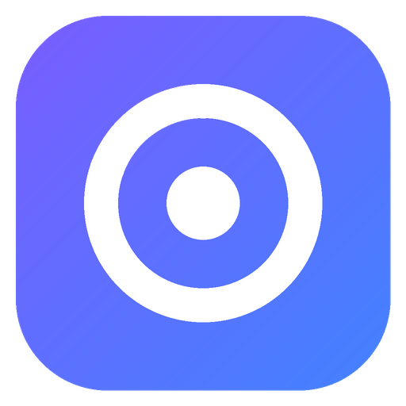
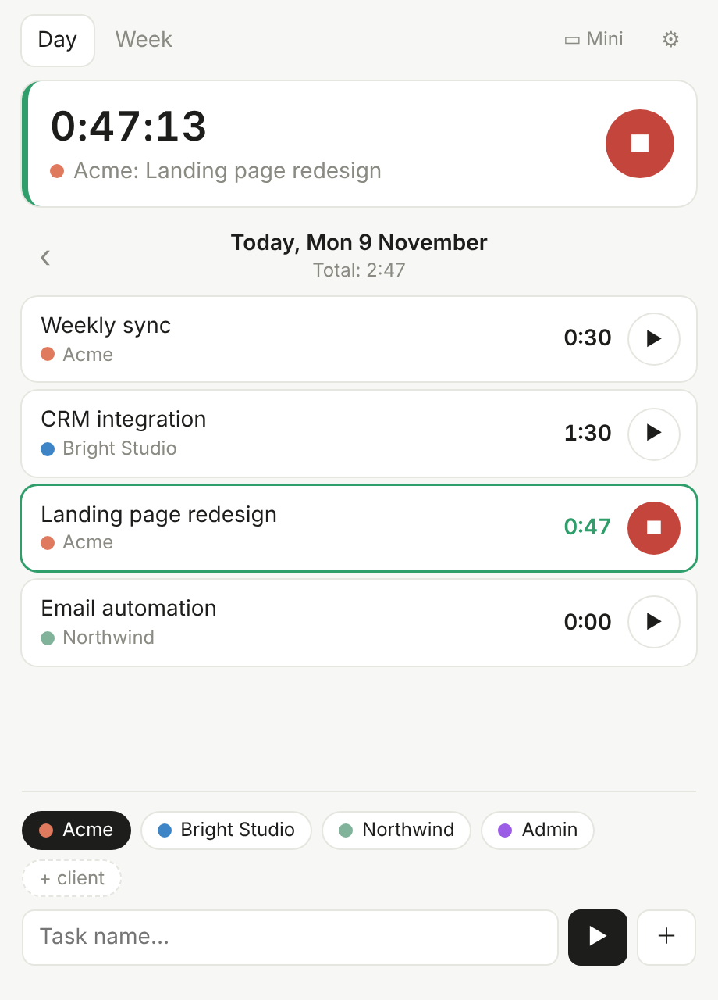
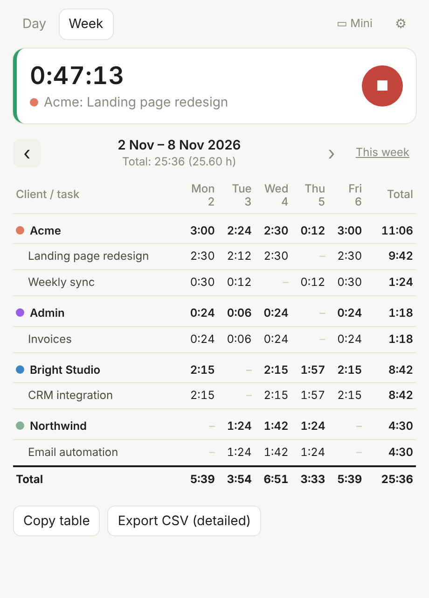
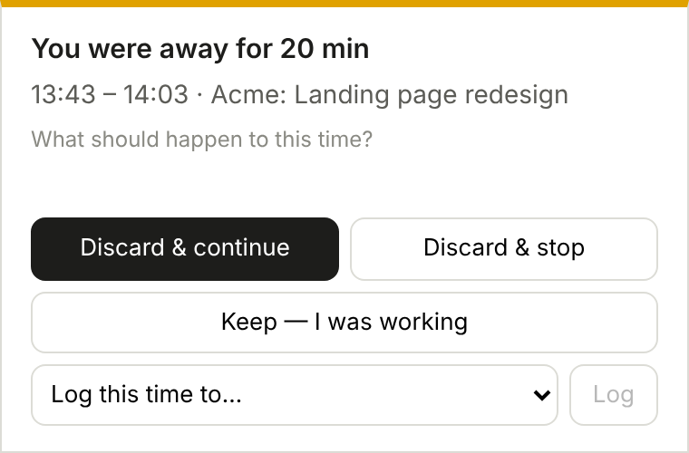
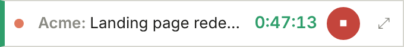

<p align="center">
  
</p>

<h1 align="center">Focusly</h1>

<p align="center">
  A simple, minimal time tracker for client work —<br>
  track time by client and task, switch in one click, get a weekly report.
</p>

<p align="center">
  <a href="https://github.com/KateGrr/focusly/releases/latest"><b>⬇ Download for Windows</b></a>
  &nbsp;·&nbsp; <a href="#русский">Русский</a>
</p>

<p align="center">
  
  &nbsp;
  
</p>

## Features

- **Clients & tasks** — pick a client, type a task, press Enter and the timer starts. Recent tasks are one click away.
- **Instant switching** — start another task and the previous one stops automatically.
- **Fresh start every day** — each day begins at zero; previous days stay available and editable.
- **Manual corrections** — edit start/end times, add or delete intervals. Forgot to stop? Just type when you finished.
- **Idle auto-pause** — no mouse or keyboard for 10 minutes (configurable), screen lock or sleep → Focusly notices.
  When you're back it asks what to do with that time: discard it, keep it, or log it to another task.
- **Reminders** — "Still on it?" every 30 minutes, "Timer is not running" when you work without tracking,
  and an end-of-workday summary. Work days are configurable — no nagging on weekends.
- **Mini mode** — a single always-on-top line with `Client: Task`, the timer and stop/start.
- **Weekly report** — client → task → day table; copy to Google Sheets / Excel or export a detailed CSV.
- **Hide finished work** — hide clients or tasks you're done with; history and reports stay.
- **Tray & autostart** — keeps running next to the clock; optional start on login.
- **English / Русский** interface.
- **Private by design** — all data stays on your computer in a single JSON file. No accounts, no cloud.
- **Auto-updates** from GitHub Releases.

<p align="center">
  
  <br><br>
  
</p>

## Install

1. Download **`Focusly-Setup-x.y.z.exe`** from the [latest release](https://github.com/KateGrr/focusly/releases/latest) and run it.
2. Windows may show a blue *"Windows protected your PC"* screen because the app isn't code-signed.
   Click **More info → Run anyway**. You only need to do this once.
3. Focusly appears in the Start menu and in the tray next to the clock. Language is in ⚙ Settings.

Updates install automatically: when a new version is ready, Focusly offers to restart.

## Tips

| Shortcut | Action |
|---|---|
| `Enter` in the task field | add the task and start the timer |
| `Ctrl+N` | new task |
| `Ctrl+M` | mini mode |
| `Ctrl+.` | stop the timer |

- Click a task in the day view to edit its time intervals.
- Closing the window keeps Focusly running in the tray. Quit from the tray menu.
- Your data: `%APPDATA%\Focusly\focusly-data.json` (Settings → *Open data folder*). Back it up whenever you like.

## Development

Requires [Node.js](https://nodejs.org) 20+.

```bash
npm install
npm start          # run the app
npm run dist:win   # build the Windows installer into dist/
```

**Releasing a new version:** bump `version` in `package.json` and push to `main`.
GitHub Actions builds the installer on Windows, creates the `vX.Y.Z` release and uploads it;
installed apps pick up the update automatically. You can also run it manually: *Actions → Release → Run workflow*.

Project layout:

```
src/main.js      main process: windows, tray, idle detection, notifications, auto-update
src/app.js       main window UI and tracking logic
src/popup.html   reminder / away / end-of-day pop-ups
src/mini.html    mini mode
src/i18n.js      English and Russian texts
```

## License

[MIT](LICENSE)

---

## Русский

**Focusly** — простой минималистичный тайм-трекер для работы с клиентами: время по клиентам и задачам, переключение в один клик, отчёт за неделю.

**Что умеет:** клиенты и задачи с запуском в один клик и мгновенным переключением; каждый день начинается с нуля,
прошлые дни можно открыть и поправить; ручная правка интервалов; автопауза при бездействии, блокировке экрана и сне
с вопросом при возвращении («убрать время», «оставить» или «записать на другую задачу»); напоминания «продолжаем?»,
«таймер не запущен» и «конец рабочего дня» с учётом рабочих дней; мини-режим поверх всех окон; недельный отчёт
с копированием в Google Sheets / Excel и экспортом CSV; скрытие завершённых клиентов и задач; трей и автозапуск;
интерфейс на английском и русском; автообновление. Все данные хранятся только у тебя на компьютере.

**Установка:**
1. Скачай **`Focusly-Setup-x.y.z.exe`** со страницы [последнего релиза](https://github.com/KateGrr/focusly/releases/latest) и запусти.
2. Если Windows покажет синее окно «Система Windows защитила ваш компьютер» — это потому, что у приложения
   нет платной цифровой подписи. Нажми **«Подробнее» → «Выполнить в любом случае»**. Это нужно только один раз.
3. Focusly появится в «Пуске» и в трее у часов. Язык переключается в ⚙ → Language.

Обновления ставятся сами: когда выйдет новая версия, Focusly предложит перезапуститься.
Данные лежат в `%APPDATA%\Focusly\focusly-data.json`.
